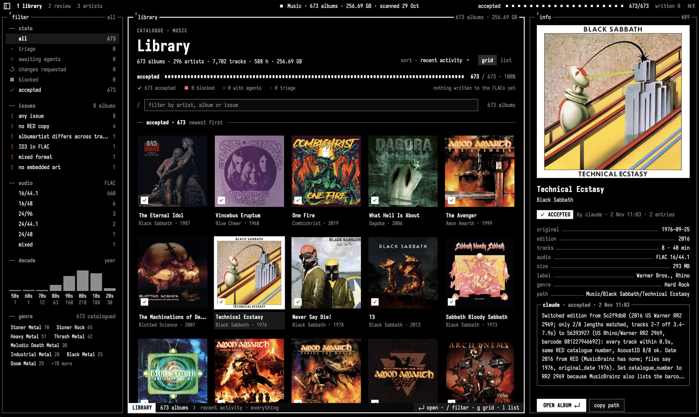
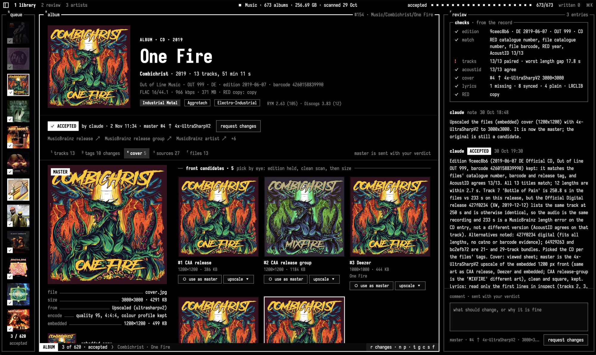
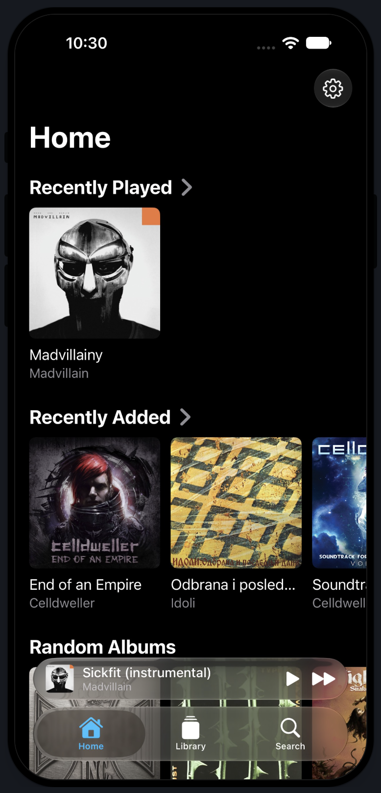
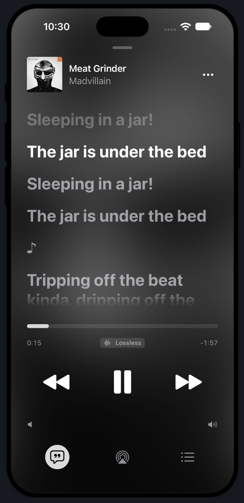
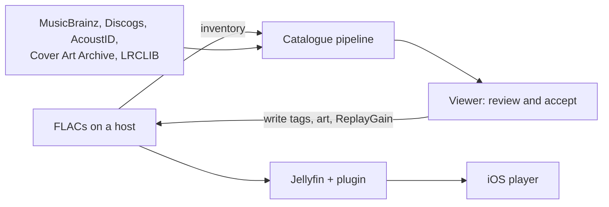

# journey.fm

My personal music stack consisting of:

- Catalogue and tagger web app for my FLAC library
- Jellyfin plugin that serves my custom tags
- Jellyfin client for iOS in pure Swift

Published as-is, feel free to use as inspiration or give to your agent!

## Screenshots


| Library                                                       | Album review                                                                 |
| ------------------------------------------------------------- | ---------------------------------------------------------------------------- |
|  |  |


| Home                                                                           | Lyrics                                                                                 |
| ------------------------------------------------------------------------------ | -------------------------------------------------------------------------------------- |
|  |  |




## Parts

- `packages/catalogue`, `tools/tagging`: find each album's exact
MusicBrainz edition, gather covers, credits and synced lyrics, resolve
one record per album, and write it to the files with `metaflac`.
Rules in [`docs/catalogue.md`](docs/catalogue.md).
- `apps/web`: the viewer. What the files say, what the catalogue
proposes, what each source said, cover candidates, accept or request
changes.
- `apps/jellyfin`: a Jellyfin plugin that maps the tags into Jellyfin's
fields (credits, original dates, ratings, everything else as
`KEY:Value` tags) and streams whole albums as one archive.
- `apps/ios`: a SwiftUI player for that Jellyfin. The library lives in a
database on the phone, search is offline, playback is gapless and
starts while a track is still downloading, and the whole library can
be saved in the background. Design and roadmap in
[`docs/ios.md`](docs/ios.md).

## Requirements

- [mise](https://mise.jdx.dev), which installs Bun and .NET
- `ffmpeg`, `rsync` and `ssh` here; a host with the FLACs under
`Music/<Artist>/<Album>/`, reachable over ssh, with `bun`, `flac`
(for `metaflac`), `fpcalc` and `sqlite3`
- Jellyfin 12.4 for the plugin
- A Mac with Xcode 26 and XcodeGen for the app

## Getting started

```sh
cp mise.example.toml mise.local.toml    # then fill it in
mise install && bun install
mise run inventory                      # scan the host, pull the result
mise run prepare "Music/Artist/Album"   # resolve one album
mise run dev                            # viewer on localhost:8786
mise run write <slug> --plan            # the tags it would write
```

`mise tasks` lists the rest. For the app, copy
`apps/ios/Local.example.xcconfig` to `Local.xcconfig`, then `mise run ios sim`. [`AGENTS.md`](AGENTS.md) describes how a batch of albums is
run with agents reviewing.

## Licence

The code is MIT. See [`LICENSE`](LICENSE).

The Jellyfin plugin in `apps/jellyfin` is GPL-3.0-only, because it links
Jellyfin's GPL packages. See
[`apps/jellyfin/LICENSE`](apps/jellyfin/LICENSE).

The Iosevka fonts in `apps/web/public/fonts` are under the SIL Open Font
License. See [`OFL.md`](apps/web/public/fonts/OFL.md).